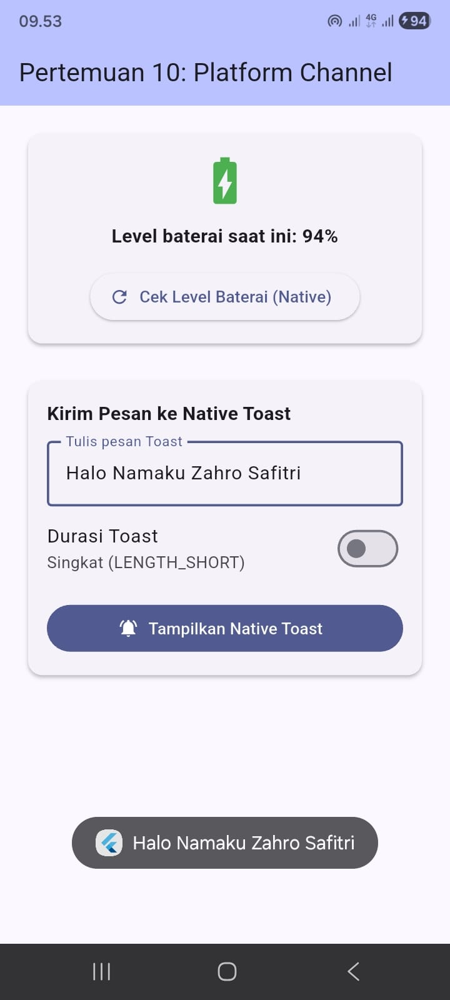
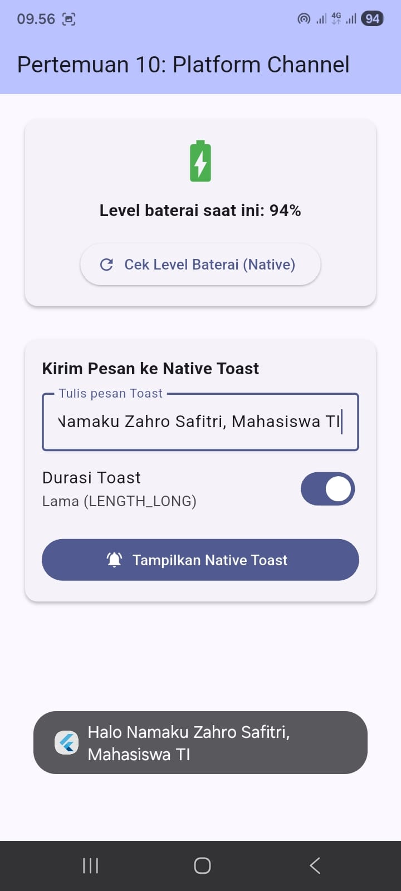

# Latihan Flutter Android: Platform Channel

Tugas Pertemuan 10 mata kuliah Pemrograman Multi Platform Lanjutan.

Aplikasi ini memakai **MethodChannel** untuk menghubungkan Flutter (Dart) dengan sistem native Android (Kotlin). Ada dua alur komunikasi:

1. **Native ke Flutter**: Flutter meminta level baterai, lalu Android mengirim hasilnya lewat `BatteryManager`.
2. **Flutter ke Native**: Flutter mengirim teks dan durasi, lalu Android menampilkannya sebagai Native Toast.

## Identitas

- Nama: Zahro Safitri
- NIM: 2411500063
- Kelas: TA5J

## Fitur

| Fitur | Arah data | Method | Hasil |
| --- | --- | --- | --- |
| Cek level baterai | Native ke Flutter | `getBatteryLevel` | Persentase baterai tampil di layar |
| Native Toast | Flutter ke Native | `showToast` | Toast muncul dengan teks dari input |
| Durasi Toast (latihan) | Flutter ke Native | `showToast` dengan argumen `isLong` | Toast singkat atau lama sesuai saklar |

## File penting

- `lib/main.dart`: kode Flutter (tampilan dan pemanggil channel)
- `android/app/src/main/kotlin/com/example/latihan_flutter_android/MainActivity.kt`: kode native Android

## Cara kerja singkat

1. Sisi Flutter dan Android memakai nama channel yang sama persis: `com.example.app/battery`.
2. Flutter memanggil `platform.invokeMethod('namaMethod', argumen)`.
3. Di Android, `setMethodCallHandler` membaca `call.method` lalu menjalankan logika native.
4. Hasilnya dikembalikan lewat `result.success(...)`, `result.error(...)`, atau `result.notImplemented()`.

## Latihan: durasi Toast

Flutter mengirim argumen kedua bernama `isLong` bertipe `bool`. Di `MainActivity.kt`, argumen itu dibaca dengan nilai bawaan `false`, lalu dipakai untuk memilih `Toast.LENGTH_LONG` atau `Toast.LENGTH_SHORT`. Di layar ada saklar **Toast durasi lama** untuk mengatur nilainya.

## Cara menjalankan

Prasyarat: Flutter SDK, Android SDK, dan HP Android dengan USB Debugging aktif (atau emulator).

```
flutter pub get
flutter devices
flutter run -d <id_perangkat>
```

Pilih perangkat Android, bukan Chrome, Edge, atau Windows. Setiap kali kode Kotlin diubah, hentikan aplikasi lalu jalankan ulang dengan `flutter run`.

## Kriteria keberhasilan

- [x] Aplikasi berjalan di perangkat Android
- [x] Tombol baterai menampilkan persentase yang valid
- [x] Input teks Flutter muncul sebagai Native Toast
- [x] Tidak ada `MissingPluginException`
- [x] Latihan `isLong` berfungsi

## Bukti hasil uji

Perangkat uji: Samsung SM-A075F, Android 16 (API 36).

Pada kedua screenshot, hasil cek baterai ikut tampil di card atas, sedangkan Toast muncul di bagian bawah layar.

**Toast durasi singkat** (saklar mati, `Toast.LENGTH_SHORT`)



**Toast durasi lama** (saklar menyala, `Toast.LENGTH_LONG`)



## Referensi

- [Flutter Platform Channels](https://docs.flutter.dev/platform-integration/platform-channels)
- [Contoh resmi platform_channel](https://github.com/flutter/samples/tree/main/platform_channel)